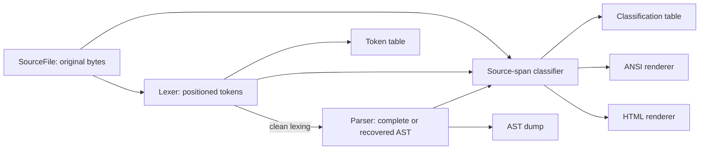

# Phase-one handoff and review guide

The phase-one front end is complete for the selected base B-Minor grammar. It
loads source, scans positioned tokens, parses a complete or recovered AST,
classifies original source spans using AST context and renders ANSI or standalone
HTML. The same repository and AST extension points remain available for later
semantic/code-generation phases.

## Reproduce the result

Use the `phase1-final` Git tag for the completed snapshot, or extract the supplied
source ZIP. Keep the repository history when continuing development; the ZIP
is a source-only convenience copy and does not contain `.git` history.

```powershell
powershell -NoProfile -ExecutionPolicy Bypass -File .\verify.ps1
powershell -NoProfile -ExecutionPolicy Bypass -File .\run.ps1 -Source examples/html_preview.bminor -Html
```

The verification summary is `build/verify/phase1-review/summary.md`; the browser
preview is `output/highlight.html`. Read [testing.md](testing.md) for the exact
environment, cases and expected statuses. No local reference PDFs, development
scratch files, existing build cache or network download are needed to build.

To reproduce the source archive from a Git checkout:

```powershell
New-Item -ItemType Directory -Force output | Out-Null
git archive --format=zip --output=output/compiler-project-phase1.zip phase1-final
```

The archive contains tracked C++ source/headers, CMake configuration, both
PowerShell scripts, examples, tests and documentation. Generated HTML/ANSI and
verification captures are recreated by running the project; they are excluded
from the source archive along with binaries and private reference material.

## Architecture



`SourceFile` owns unchanged binary input. Tokens own their text and coordinates.
The parser borrows tokens while parsing, but returned AST nodes own their
children with `unique_ptr` and retain their own locations/text. A nullable
`shared_ptr<const TypeInfo>` annotation is reserved for semantic analysis and
stays separate from the `TypeSyntax` describing a written type.

Classification returns offsets, lengths, roles and independent error flags; it
does not copy or reconstruct the source. Its const AST traversal marks the exact
occurrence of a name. Both renderers validate complete coverage and read original
source slices, so comments and formatting survive even though the parser ignores
trivia for syntax decisions.

## Requirement-to-evidence map

| Phase-one requirement | Implementation | Documentation / executable evidence |
| --- | --- | --- |
| Formal lexical rules and priority | `src/lexer.cpp`, token model | [lexical-rules.md](lexical-rules.md), lexer/diagnostic suites, `--tokens --show-whitespace` |
| B-Minor grammar and parser strategy | `src/parser.cpp` | [grammar.ebnf](grammar.ebnf), [parser-design.md](parser-design.md), parser/expression/statement suites |
| Positioned AST with future type fields | `include/bminor/ast.hpp`, `src/ast.cpp` | `--ast`, ownership/location tests and the code walkthrough |
| Lexical and panic-mode syntax recovery | Lexer diagnostics and parser synchronization | [error-recovery.md](error-recovery.md), error examples and recovery suite |
| AST-based function/variable distinction | `src/syntax_classifier.cpp` | [syntax-classification.md](syntax-classification.md), repeated `work` occurrences and classifier tests |
| ANSI output preserving source | `src/ansi_renderer.cpp` | [ansi-rendering.md](ansi-rendering.md), exact binary output tests |
| Independent HTML/CSS output | `src/html_renderer.cpp` | [html-rendering.md](html-rendering.md), literal markup demo, HTML/CLI tests |
| Modular C++ and reproducible checks | `bminor_core`, CLI, tests, `verify.ps1` | [testing.md](testing.md), 18 CTest targets and the retained pipeline matrix |
| Continuous development history | Same Git repository throughout the 12 steps | [progress.md](progress.md), [roadmap.md](roadmap.md), descriptive commits and `phase1-final` |

## Algorithms and design choices

The scanner walks input bytes once, using explicit ASCII character classes,
maximal munch and keyword lookup after complete words. Comment openers precede
division; supported two-byte operators precede their single-byte forms. Raw
lexemes remain available for display and later phases. Scanning takes linear
time in source size, with retained text/tokens/diagnostics using linear storage.

The handwritten recursive-descent parser follows the documented nonterminals.
Precedence levels share a left-fold helper for left-associative operators;
assignment and power recurse on the right. Group nodes retain parentheses'
source locations. Most choices use one significant token; an identifier followed
by a colon distinguishes local declarations. An else attaches to the nearest
unmatched if. Optional for-header expressions remain null rather than becoming
synthetic expressions.

Errors collect structured diagnostics. Lexing continues through invalid tokens;
lexical failures gate AST startup to avoid duplicate parser messages. Clean
lexing permits panic-mode synchronization at declaration/statement boundaries,
with explicit error nodes and preserved following siblings. Delimiter ownership
keeps an owning else/brace available to its parent. EOF blocks can be incomplete.
Both active recursion and expression-tree height are capped at 128, including
long iterative operator chains; shallow wide programs remain accepted.

Classification begins with lexical categories and refines names through AST
nodes, matching filename, byte offset and length with binary search. It never
uses a global spelling map or guesses a call from the following parenthesis.
Error ranges decorate surviving categories independently. Lexical failures
retain full lexical spans without inventing AST-based name roles.

Rendering is linear in source/spans plus output size. ANSI inserts styles and
immediate resets without altering source bytes. HTML escapes source/metadata,
embeds CSS and preserves whitespace with a pre/code block; CR references retain
browser DOM text. Unsupported controls/malformed UTF-8 use a documented visible
byte fallback. File HTML export buffers a complete document before opening the
destination and checks writes/close; stdout renderers check their final flush.
The Windows-only CLI adapter suppresses CRT newline translation. Core analysis
and rendering use standard C++11 without external libraries.

## Suggested live demonstration

1. Run `verify.ps1` and open the pipeline summary; explain why expected error
   exit codes still yield a successful test run.
2. Inspect `examples/html_preview.bminor --tokens --show-whitespace`; show that
   the string's tags and quotes stay inside literal tokens.
3. Inspect `examples/expressions.bminor --ast`; explain `1+2*3`, right-associated
   power/assignment and explicit group/call/index nodes.
4. Inspect `examples/statements.bminor --ast`; show local declarations, nested
   blocks, nearest else and missing for-header fields.
5. Run `examples/syntax_errors.bminor --ast`; identify all five messages, error
   nodes and the surviving final return/global declaration. Contrast lexical
   fallback using `examples/lexical_errors.bminor`.
6. Display `examples/classification.bminor --classify`; explain why different
   occurrences of `work` become declarations, calls or value references.
7. Render `examples/html_preview.bminor --ansi` and export HTML; show default
   variable colors, named-call colors, literal HTML text and retained formatting.

These are executable options after building, for example
`.\build\bminor.exe --ast examples/statements.bminor`. Use `run.ps1` switches
when building and running together. The browser preview does not execute B-Minor.

For a small code change, begin with [code-walkthrough.md](code-walkthrough.md).
Changing a color belongs in a renderer; changing a name's syntactic role belongs
in the classifier; changing accepted syntax requires grammar/parser/test updates.

## Explicit scope and remaining phases

The course ZIP did not provide a complete B-Minor dialect definition. The user
approved the base textbook version; formal rules and explicit choices are
recorded in the lexical/grammar guides. `while` is reserved but has no statement
rule; `auto` and floating-point extensions are not added. Function return types
are atomic/void, array variables require bounds and array parameters may omit
them. Unary plus, compound assignments, nested functions and for-header variable
declarations are outside the selected grammar.

Phase one does not resolve symbols, infer/check types, validate assignment
targets, require main, execute source or emit machine code. Some syntax samples
intentionally exercise forms that later semantic checks may reject. Input length
limits and parser depth limits are implementation constraints, not semantic
validation. Future phases can attach resolved types to existing AST nodes and
add new diagnostics/tests while retaining this source/history and syntax suite.
